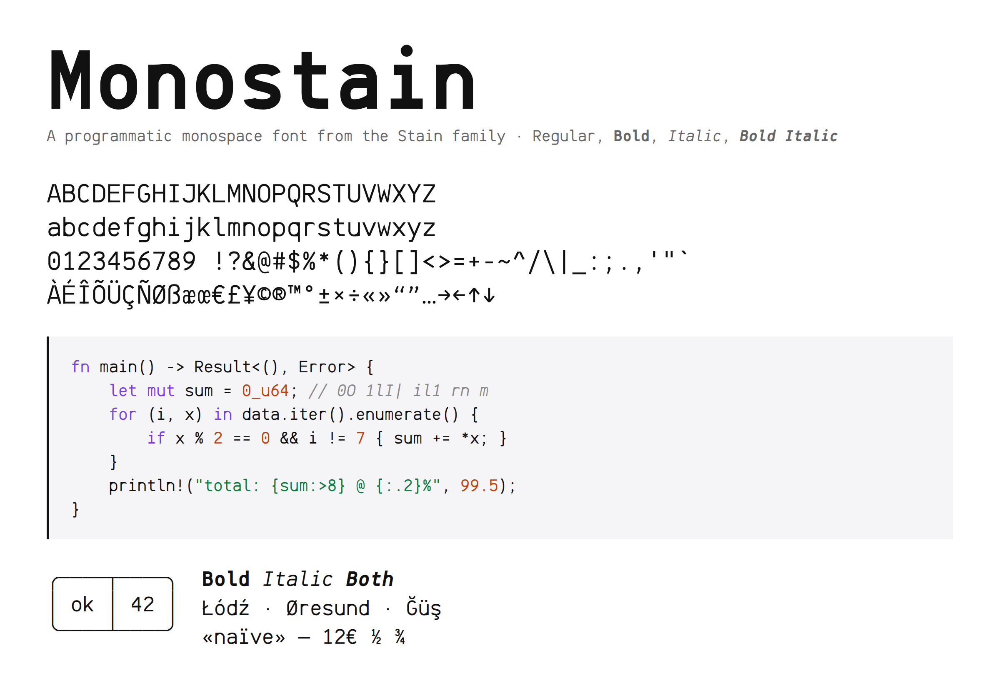

# Monostain

Monostain is a free, programmatic monospace font from the [Stain](https://github.com/PlanetRenox/StainFont) family, inspired by JetBrains Mono.

Every glyph is written in code as centerlines, which [skia-pathops](https://github.com/fonttools/skia-pathops) strokes at the weight's width and merges into one outline. Arches and bowls (n h m b d p q) are filled bands instead, so they thin where they meet the stem. Bold is the same drawing with a thicker stroke, and the italics lean 10°.

- Regular, Bold, Italic and Bold Italic, every glyph 600 units wide
- 383 characters: ASCII, Latin-1, Latin Extended-A, curly quotes, dashes, currency, math, arrows, box drawing and blocks
- `0` has a dot, and `1 l I |` all look different

## Usage

To use Monostain in your project without downloading, import it via CDN:

    @font-face {
      font-family: "Monostain";
      src: url("https://cdn.jsdelivr.net/gh/PlanetRenox/MonostainFont@1.0/dist/Monostain-Regular.woff2") format("woff2");
      font-weight: 400;
    }
    @font-face {
      font-family: "Monostain";
      src: url("https://cdn.jsdelivr.net/gh/PlanetRenox/MonostainFont@1.0/dist/Monostain-Bold.woff2") format("woff2");
      font-weight: 700;
    }
    @font-face {
      font-family: "Monostain";
      src: url("https://cdn.jsdelivr.net/gh/PlanetRenox/MonostainFont@1.0/dist/Monostain-Italic.woff2") format("woff2");
      font-weight: 400;
      font-style: italic;
    }
    @font-face {
      font-family: "Monostain";
      src: url("https://cdn.jsdelivr.net/gh/PlanetRenox/MonostainFont@1.0/dist/Monostain-BoldItalic.woff2") format("woff2");
      font-weight: 700;
      font-style: italic;
    }

    code, pre {
      font-family: "Monostain", monospace;
    }

For editors and terminals, install the `.otf` or `.ttf` files from [dist](dist).

## Build

Needs [uv](https://docs.astral.sh/uv/).

    uv run build.py   # writes dist/, the same bytes every time
    uv run check.py   # flags glyphs whose outlines came out with seams or slivers

The glyphs live in `src/`: `core.py` is the drawing kit, then `lower.py`, `upper.py`, `figures.py`, `symbols.py` and `marks.py` (accents, the accented letters built from Unicode's decompositions, and ligatures).

## License

[CC0 1.0 Universal](LICENSE). Use it however you want, no attribution needed.
